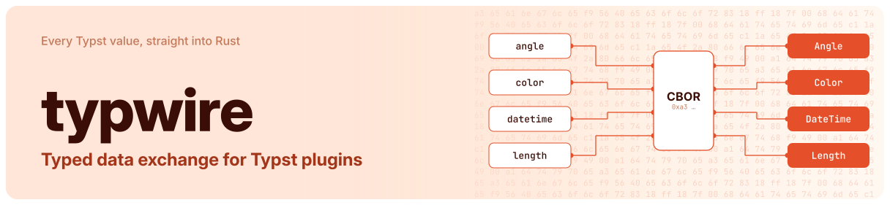

# typwire

Typed data exchange between Typst and (Rust) WASM plugins.

## Installation

Add the Rust crate to a plugin:

```sh
cargo add typwire
```

Add the Typst package to a document:

```typ
#import "@preview/typwire:0.3.0"
```

## Quick Start

Export a plugin function from Rust:

```rust
use typwire::{Length, initiate_protocol};

initiate_protocol!();

#[typwire::export]
fn measure(label: String, scale: f64) -> Result<(String, Length), String> {
    Ok((format!("{label}{scale}"), Length::new(12.0 * scale)))
}
```

Call the plugin function from Typst:

```typ
#import "@preview/typwire:0.3.0"

#let plugin = plugin("plugin.wasm")
#let (text, width) = typwire.call(plugin.measure, "Value: ", 1.5)

#assert(text == "Value: 1.5")
#assert(width == 18pt)
```

## Reference

### `typwire`

```typ
/// Calls a plugin function: encodes each positional argument
/// independently, invokes the export, and decodes its single return
/// value. Named arguments are not supported.
/// -> any
#let call(function, ..args, format: "cbor") = { /* .. */ }
```

```typ
/// Encodes a value into the given format's bytes/string.
/// -> bytes, str
#let encode(value, format: "cbor") = { /* .. */ }
```

```typ
/// Decodes the given format's bytes/string and reconstructs supported
/// native Typst values.
/// -> any
#let decode(data, format: "cbor") = { /* .. */ }
```

### `typwire.debug`

Useful for inspecting or testing the wire shape Typwire produces without going through an actual format or a plugin round trip.

```typ
/// Encodes a value into the shared tree, with no serialization.
/// -> any
#let encode(value, format: "cbor") = { /* .. */ }
```

```typ
/// The mirror of `encode`: reconstructs native Typst values from a tree
/// that was never serialized.
/// -> any
#let decode(data, format: "cbor") = { /* .. */ }
```

<details>
<summary><code>typwire.cbor</code></summary>

```typ
/// Encodes a value into CBOR bytes.
/// -> bytes
#let encode(value) = { /* .. */ }
```

```typ
/// Decodes CBOR bytes and reconstructs supported native Typst values.
/// -> any
#let decode(data) = { /* .. */ }
```

```typ
/// Calls a plugin function with positional arguments, using CBOR.
/// -> any
#let call(function, ..args) = { /* .. */ }
```

</details>

<details>
<summary><code>typwire.json</code></summary>

```typ
/// Encodes a value into a JSON string. JSON has no native byte-string
/// type, so any `bytes` value is rewritten into a tagged array first.
/// -> str
#let encode(value) = { /* .. */ }
```

```typ
/// Decodes a JSON string or bytes and reconstructs supported native Typst
/// values.
/// -> any
#let decode(data) = { /* .. */ }
```

```typ
/// Calls a plugin function with positional arguments, using JSON.
/// -> any
#let call(function, ..args) = { /* .. */ }
```

</details>

## Wire shapes

The actual Typst dictionary each tagged type above round-trips as: The
same shape `typwire.debug.encode` returns.

Inside a color or gradient, the
enclosing tag already says what each field is, so nested ratios and angles
are bare floats there (a fraction, and radians) rather than tagged
dictionaries of their own.

Native primitives (`int`, `float`, `bool`, `str`, `none`, `array`,
`dictionary`) aren't repeated here; they pass through untagged.

#### Foundations

##### Auto

```typ
#let shape = (typwire-type: "auto")
```

##### Type

```typ
#let shape = (typwire-type: "type", ty: "int")
```

##### Label

```typ
#let shape = (typwire-type: "label", name: "intro")
```

##### Version

```typ
#let shape = (typwire-type: "version", components: (1, 2, 3))
```

##### Symbol

```typ
#let shape = (
  typwire-type: "symbol",
  default: "→",
  variants: ((modifiers: "double", glyph: "⇒"),),
)
```

**Note:** `symbol` uses `repr()` to access the variants, whose output is unstable and might change any time. Use this type with caution. 

##### Path

```typ
#let shape = (typwire-type: "path", path: "assets/logo.svg")
```

**Note:** `path` uses `repr()` to recover its text, whose output is unstable and might change any time. Use
this type with caution.

##### Regex

```typ
#let shape = (typwire-type: "regex", pattern: "\d+")
```

**Note:** `regex` uses `repr()` to recover its pattern, whose output is unstable and might change any time. Use
this type with caution. Requires the `regex` feature on the Rust side.

##### Decimal

```typ
#let shape = (typwire-type: "decimal", decimal: "3.14")
```

**Note:** Requires the `decimal` feature on the Rust side.

##### Datetime

```typ
#let shape = (
  typwire-type: "datetime",
  year: 2024,
  month: 1,
  day: 1,
  hour: none,
  minute: none,
  second: none,
)
```

##### Duration

```typ
#let shape = (typwire-type: "duration", seconds: 3600.0)
```

##### Arguments

```typ
#let shape = (typwire-type: "arguments", pos: (1, "two"), named: (flag: true))
```

##### Bytes

```typ
#let shape = (typwire-type: "bytes", data: (1, 2, 3))
```

**Note:** Only used by JSON; CBOR keeps a native byte string.

#### Layout

##### Angle

```typ
#let shape = (typwire-type: "angle", radians: 1.5707963267948966)
```

##### Length

```typ
#let shape = (typwire-type: "length", points: 28.35)
```

##### Ratio

```typ
#let shape = (typwire-type: "ratio", ratio: 0.5)
```

##### Alignment

```typ
#let shape = (typwire-type: "alignment", x: "left", y: none)
```

#### Visualize

##### Color

```typ
#let shape = (typwire-type: "color-luma", lightness: 1.0, alpha: 1.0)
```

```typ
#let shape = (typwire-type: "color-rgb", r: 1.0, g: 0.0, b: 0.0, alpha: 1.0)
```

```typ
#let shape = (typwire-type: "color-linear-rgb", r: 1.0, g: 0.0, b: 0.0, alpha: 1.0)
```

```typ
#let shape = (typwire-type: "color-cmyk", cyan: 0.0, magenta: 1.0, yellow: 1.0, key: 0.0)
```

```typ
#let shape = (
  typwire-type: "color-hsl",
  hue: 0.0,
  saturation: 1.0, lightness: 0.5, alpha: 1.0,
)
```

```typ
#let shape = (
  typwire-type: "color-hsv",
  hue: 0.0,
  saturation: 1.0, value: 1.0, alpha: 1.0,
)
```

```typ
#let shape = (typwire-type: "color-oklab", lightness: 0.63, a: 0.22, b: 0.13, alpha: 1.0)
```

```typ
#let shape = (
  typwire-type: "color-oklch",
  lightness: 0.63, chroma: 0.26,
  hue: 0.72,
  alpha: 1.0,
)
```

##### Gradient

```typ
#let shape = (
  typwire-type: "gradient-linear",
  stops: ((color: (typwire-type: "color-rgb", r: 1.0, g: 0.0, b: 0.0, alpha: 1.0), offset: 0.0),),
  angle: 0.0,
  space: "rgb",
)
```

```typ
#let shape = (
  typwire-type: "gradient-radial",
  stops: (/* stop, stop, ... */),
  center: (x: 0.5, y: 0.5),
  radius: 0.5,
  focal-center: (x: 0.5, y: 0.5),
  focal-radius: 0.0,
  space: "rgb",
)
```

```typ
#let shape = (
  typwire-type: "gradient-conic",
  stops: (/* stop, stop, ... */),
  angle: 0.0,
  center: (x: 0.5, y: 0.5),
  space: "rgb",
)
```

##### Stroke

```typ
#let shape = (
  typwire-type: "stroke",
  paint: (typwire-type: "color-rgb", r: 0.0, g: 0.0, b: 0.0, alpha: 1.0),
  thickness: (typwire-type: "length", points: 1.0),
  cap: "round",
  join: "round",
  dash: none,
  miter-limit: 4.0,
)
```

## Performance

If you're considering moving a pure-Typst implementation to a WASM plugin
via typwire, be aware of the performance overhead that comes with it:

These measurements were taken with medium-sized data, like a gradient with 9 stops. Performance scales directly with the size of the data.

- **~10 ms** to load the plugin. Paid once per compilation, no matter how
  many times it's called afterward.
- **~1 ms** extra for the first call specifically, before per-call cost
  settles.
- **~150 μs** per call after that.

If no specific format is desired, or performance matters, use CBOR. JSON is
measurably slower:

| Format | Relative speed |
| :-: | :-: |
| CBOR | 1x (baseline) |
| JSON | ~2.5x |

### Comparison with sertyp

[sertyp](https://typst.app/universe/package/sertyp) solves a similar problem and
is considerably more feature-rich (for example, it can serialize `content`,
functions and styles, which typwire deliberately does not). typwire instead
specializes in performance. Time spent on the plugin round trip, CBOR only:

| Workload | typwire | sertyp | Speedup |
| :- | -: | -: | -: |
| 6000 integers | ~14 ms | ~943 ms | ~66x |
| 1000 small dictionaries | ~26 ms | ~372 ms | ~14x |
| 300 calls, one gradient each | ~54 ms | ~993 ms | ~18x |
| 40 kB of bytes | ~9 ms | ~19 ms | ~2x |

sertyp also fails on larger payloads (a few thousand nodes) because its
deserializer hits Typst's loop-iteration limit. See the full
[benchmark results](benchmarks/RESULT.md) for more workloads and how they were
measured.

## Version compatibility

The Rust crate and the Typst package are versioned together and must be on
the **exact same version**. There is no compatibility guarantee across a version mismatch.

## License

`typwire` is available under the MIT OR Apache-2.0 license. See [LICENSE-MIT](LICENSE-MIT) and [LICENSE-APACHE](LICENSE-APACHE) for details.
