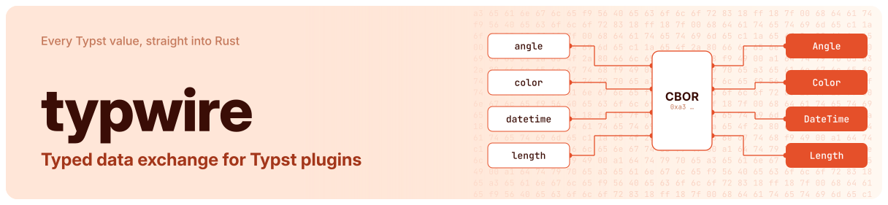

# typwire

Typed data exchange between Typst and (Rust) WASM plugins.

## Installation

Add the Rust crate to a plugin:

```sh
cargo add typwire
cargo add serde --features derive
```

Add the Typst package to a document:

```typ
#import "@preview/typwire:0.2.0"
```

## Quick Start

Export a plugin function from Rust:

```rust
use serde::{Deserialize, Serialize};
use typwire::{Any, Length, OneOf3, Typwire, initiate_protocol};

initiate_protocol!();

#[derive(Serialize, Deserialize, Typwire)]
struct Options {
    label: String,
    scale: f64,
}

#[derive(Serialize, Deserialize, Typwire)]
struct Report {
    text: String,
    width: Length,
    metadata: Any,
}

#[typwire::export]
fn measure(
    value: OneOf3<i64, f64, String>,
    options: Options,
    fallback: Option<Length>,
    metadata: Any,
) -> Result<Report, String> {
    let value = match value {
        OneOf3::First(value) => value.to_string(),
        OneOf3::Second(value) => value.to_string(),
        OneOf3::Third(value) => value,
    };

    Ok(Report {
        text: format!("{}{}", options.label, value),
        width: fallback.unwrap_or_else(|| Length::new(12.0 * options.scale)),
        metadata,
    })
}
```

Call the plugin function from Typst:

```typ
#import "@preview/typwire:0.2.0"

#let plugin = plugin("plugin.wasm")
#let report = typwire.call(
  plugin.measure,
  42,
  (label: "Value: ", scale: 1.5),
  12pt,
  (source: "example", enabled: true),
)

#assert(report.text == "Value: 42")
#assert(report.width == 12pt)
```

## Performance

If you're considering moving a pure-Typst implementation to a WASM plugin
via typwire, be aware of the performance overhead that comes with it. These
measurements were taken with medium-sized data, like a gradient with 9 stops;
performance scales directly with the size of the data.

- **~10 ms** to load the plugin, once per compilation.
- **~1 ms** extra for the first call.
- **~150 μs** per call after that.

Use CBOR unless you specifically need JSON, which is ~2.5x slower. Compared
to [sertyp](https://typst.app/universe/package/sertyp), typwire is ~2x to
~66x faster, depending on the workload. See the full
[benchmark results](https://github.com/T1mVo/typwire/blob/v0.2.0/benchmarks/RESULT.md).

## Version compatibility

The Rust crate and the Typst package are versioned together and must be on
the **exact same version**. There is no compatibility guarantee across a
version mismatch.

## Documentation

The Typst API reference can be found in the
[project repository](https://github.com/T1mVo/typwire#readme).

## License

`typwire` is available under the MIT OR Apache-2.0 license. See
[LICENSE-MIT](https://github.com/T1mVo/typwire/blob/main/LICENSE-MIT) and
[LICENSE-APACHE](https://github.com/T1mVo/typwire/blob/main/LICENSE-APACHE)
for details.
